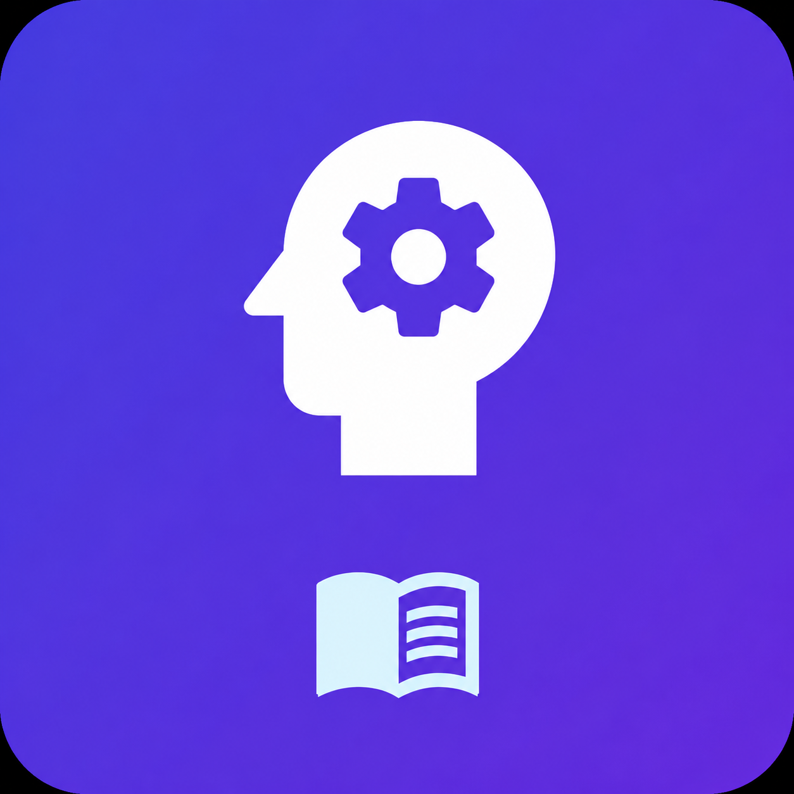

<p align="center">
  
</p>

<h1 align="center">Scholor AI</h1>

<p align="center">
  <strong>Offline-first personalized AI learning tutor and textbook reader powered by on-device quantized models and Flutter.</strong>
</p>

---

## Overview

**Scholor AI** is a mobile learning application built to solve the educational divide in low-connectivity and offline environments. It delivers an AI-powered tutor and curriculum textbook reader directly on the user's device without requiring a constant cloud connection or costly server inferences.

By combining an on-device quantized TinyStories-33M neural model executed via ONNX Runtime Mobile with local textbook retrieval from SQLite knowledge bases, Scholor AI provides real-time doubt resolution, formatted textbook reading with text-to-speech, and offline course management under strict storage and memory constraints.

---

## Features

- **Offline AI Tutor**: Local doubt clarification using an on-device quantized TinyStories-33M ONNX model paired with SQLite-grounded textbook retrieval.
- **Offline Textbook Reader**: Read curriculum textbooks (Class 1 Terms 1–3 for English, Mathematics, Environmental Science, and Tamil) with full Markdown formatting and Text-to-Speech (TTS) voice narration.
- **Curriculum & Syllabus Explorer**: Grade, subject, and term-based unit navigation extracted directly from educational EPUB textbooks.
- **Offline Multimedia Courses**: Downloadable video lesson modules with offline playback and integrated storage budget management.
- **Gamified Progress Tracking**: Daily streak counter, study goal tracking, XP levels, and local progress persistence.
- **Authentication with Offline Guest Mode**: Firebase Authentication with Google Sign-In support alongside guest mode for zero-setup offline usage.

---

## Screenshots

| Home & Progress | AI Tutor Screen | Course Detail |
| :---: | :---: | :---: |
|  |  |  |

| Offline Downloads | Onboarding Flow | Profile & Settings |
| :---: | :---: | :---: |
|  |  |  |

---

## Tech Stack

- **Application Framework**: [Flutter](https://flutter.dev/) 3.10+ / [Dart](https://dart.dev/) 3.x
- **Local Machine Learning**: [ONNX Runtime Mobile](https://onnxruntime.ai/) (`onnxruntime`), INT8 quantized 33M parameter language model
- **Local Storage & Retrieval**: SQLite (`sqflite`, `path`)
- **UI & Design System**: Material 3, Google Fonts (`Plus Jakarta Sans`, `Inter`), `flutter_animate`, `flutter_markdown`
- **Audio & Accessibility**: `flutter_tts`, `audioplayers`
- **Authentication & Cloud Sync**: Firebase Auth, Google Sign-In, Cloud Firestore
- **Textbook Parser & Preprocessing**: Python 3.10+, `ebooklib`, `beautifulsoup4`, `markdownify`

---

## Prerequisites

- **Flutter SDK**: `>=3.10.7`
- **Dart SDK**: `^3.10.7`
- **Android SDK**: API level 21 or higher (Android 5.0+)
- **Python**: 3.10+ (optional, only needed for regenerating `books.db` or training scripts)

---

## Installation & Setup

1. **Clone the repository:**
   ```bash
   git clone https://github.com/nfsprogramming/Scholor-AI.git
   cd Scholor-AI
   ```

2. **Install Flutter dependencies:**
   ```bash
   flutter pub get
   ```

3. **Verify the environment:**
   ```bash
   flutter doctor
   ```

---

## Running the Application

### Connect a Device or Emulator
```bash
flutter devices
```

### Launch in Debug Mode
```bash
flutter run
```

---

## Building Release Artefacts

### Build Android APK
```bash
flutter build apk --release
```
The compiled APK will be generated at `build/app/outputs/flutter-apk/app-release.apk`.

### Build Android App Bundle (AAB)
```bash
flutter build appbundle --release
```
The compiled AAB will be generated at `build/app/outputs/bundle/release/app-release.aab`.

---

## Testing & Quality Assurance

### Run Unit and Widget Tests
```bash
flutter test
```

### Run Static Analysis
```bash
flutter analyze
```

---

## Project Structure

```
Scholor-AI/
├── assets/                  # Application branding and local knowledge databases
│   ├── app_logo.png         # Main application icon & splash asset
│   ├── books.db             # Extracted SQLite database of curriculum textbooks
│   └── scholor_knowledge.db # Knowledge database for grounded contextual retrieval
├── Books/                   # Source Tamil Nadu State Board EPUB curriculum textbooks
├── design/ui_specs/         # UI/UX design tokens, specifications, and Stitch screen captures
├── docs/                    # Architecture documentation and dataset benchmark reports
├── lib/                     # Application source code
│   ├── core/services/       # Textbook database repository queries
│   ├── screens/             # UI screens (Home, AI Tutor, Book Reader, Syllabus, etc.)
│   ├── services/            # Inference engine, SQLite retriever, app state, auth, downloads
│   ├── theme.dart           # Unified Material 3 design system and typography tokens
│   └── main.dart            # Flutter application entry point
├── scholor-offline-ai/      # Model fine-tuning, quantization, and evaluation pipeline
├── test/                    # Unit and widget test suite
├── parse_books.py           # EPUB textbook to SQLite parser and markdown converter
├── pubspec.yaml             # Flutter dependency manifest
└── LICENSE                  # MIT License
```

---

## Offline AI Pipeline

The offline intelligence stack in `scholor-offline-ai/` comprises:
1. **Extraction**: `parse_books.py` parses EPUB textbooks and structures sections into structured Markdown.
2. **Dataset Generation**: Generates instruction-context-response tuples (`docs/DATASET.md`).
3. **Quantization**: Converts FP32 weights to INT8/INT4 ONNX using Optimum for ultra-low memory footprints (<80 MB budget).
4. **On-Device Inference**: `AiInferenceService` and `RetrievalService` combine SQLite FTS/LIKE matching with ONNX Runtime Mobile for grounded answer generation.

---

## Limitations

- **Model Context Window**: The lightweight 33M foundation model operates with small sequence lengths optimized for low-end mobile CPUs (512 MB RAM footprint).
- **Curriculum Scope**: Current preloaded textbooks cover Tamil Nadu State Board Class 1 (Terms 1–3). Additional grades can be ingested via `parse_books.py`.
- **Firebase Features**: Cloud sync and Google Sign-In require active internet connectivity; when offline, the app operates in standalone guest mode.

---

## Contributing

Contributions are welcome! Please follow these steps:
1. Fork the repository.
2. Create a feature branch (`git checkout -b feature/amazing-feature`).
3. Ensure all tests pass (`flutter test`).
4. Commit your changes (`git commit -m "Add amazing feature"`).
5. Push to your branch (`git push origin feature/amazing-feature`).
6. Open a Pull Request.

---

## License

This project is licensed under the MIT License - see the [LICENSE](LICENSE) file for details.
